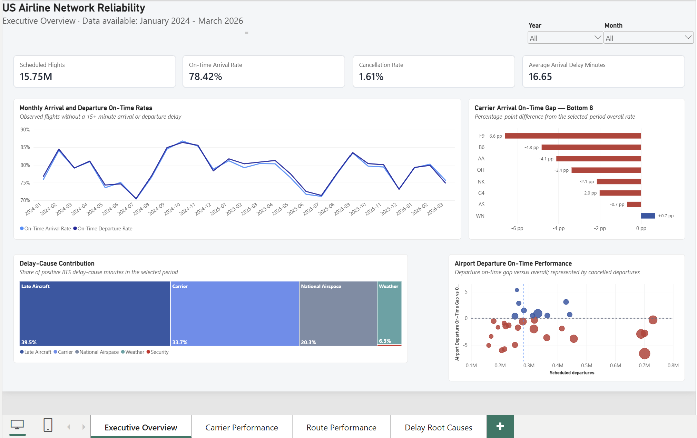
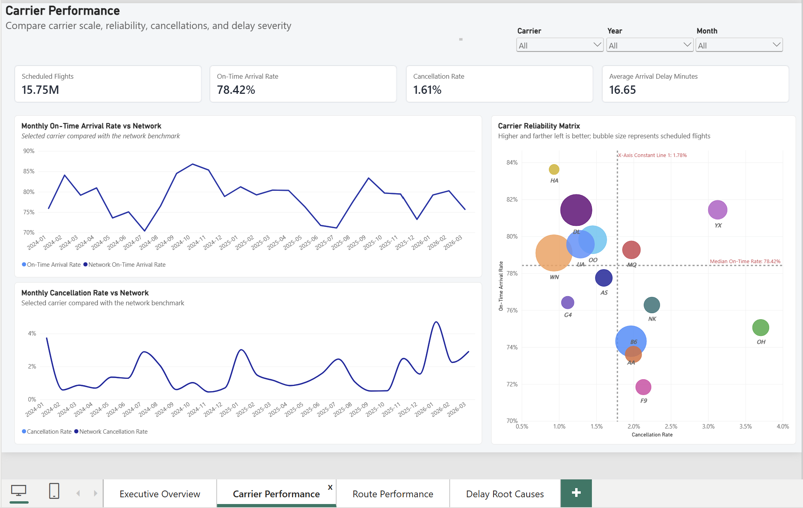
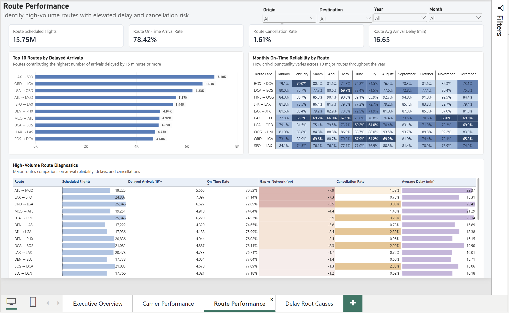
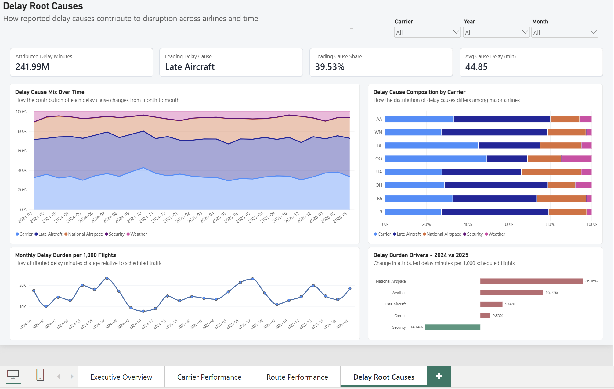
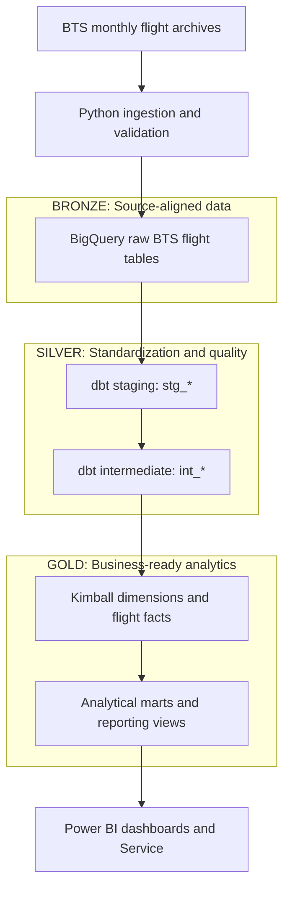

# US Airline Reliability Analytics

**Business Analytics | Analytics Engineering | Workflow Automation**

An end-to-end analytics portfolio investigating airline punctuality, cancellations, and operational disruption using U.S. Bureau of Transportation Statistics (BTS) flight data.

**Python · Google BigQuery · dbt Core · Apache Airflow · Docker · Power BI**

**Featured dashboard — Executive Overview**



*Explore the network-wide reliability metrics below, followed by the detailed operational investigations.*

| Project at a glance | Verified scope |
|---|---|
| Reporting period | January 2024 – March 2026 |
| Scheduled flight records | 15,751,822 |
| Reporting months | 27 |
| Power BI report | 4 analytical pages |
| Core approach | Kimball-inspired dimensional modeling and layered ELT |
| Automation | Guarded monthly Airflow workflows with demonstrated incremental BigQuery MERGE |

## Executive Summary

**Business problem:** Airlines must monitor both routine service reliability and exceptional disruption. Network-wide averages can conceal deteriorating routes, concentrated cancellation episodes, and differences between carriers.

This project builds a validated analytical warehouse and Power BI reporting layer to investigate those problems across historical and incremental BTS flight records.

**Data provenance and cutoff:** The source is the official [BTS TranStats Reporting Carrier On-Time Performance dataset](https://www.transtats.bts.gov/DL_SelectFields.aspx?QO_fu146_anzr=b0-gvzr&gnoyr_VQ=FGJ), published in monthly reporting periods. BTS [released March 2026 data on May 28, 2026](https://www.bts.gov/newsroom/airline-service-quality-performance-data-march-2026). The official March flight total of **612,102** matches the project's validated March ingestion count. March 2026 was deliberately selected as the final implemented reporting month for the incremental-processing demonstration; it is not presented as the latest month available from BTS.


The analysis identified a broad deterioration in arrival punctuality during Q4 2025 and a separate, severe ORD–LGA disruption in March 2026. The findings support prioritized operational investigations; they do not establish definitive causal explanations.

### Three decision-ready results

| Quantified finding | Operational decision supported |
|---|---|
| **106,435 estimated excess Q4 2025 delayed arrivals; 73.1% associated with five carriers** | Prioritize investigation of the largest carrier-level disruption exposures. |
| **93 of 237 March 2026 ORD-LGA cancellations (39.2%) occurred on three days (~10.1% of scheduled flights)** | Focus disruption-response investigation on concentrated operating-day hotspots. |
| **Matched-carrier Q4 arrival OTP fell 6.11 percentage points despite 1.58% scheduled-flight growth** | Use comparable carrier populations when interpreting reliability and capacity trends. |

**Evidence boundary:** The excess-arrivals figure is a descriptive counterfactual, not proven preventable disruption. The decisions are analytical recommendations, not implemented interventions or realized financial savings.

## 1. Business Insights & Operational Recommendations

### Finding 1 — Airline punctuality deteriorated, particularly in Q4 2025

Across all reported flights, arrival on-time performance declined from **79.18% in 2024 to 77.69% in 2025** (-1.49 percentage points). Because the reporting population changed from 15 carriers in 2024 to 14 in 2025, the apparent **1.09% decrease in all-reported scheduled flights** should not be interpreted as a like-for-like traffic decline.

A month-matched comparison revealed a much sharper deterioration toward the end of 2025.

| Month | 2024 arrival OTP | 2025 arrival OTP | Change |
|---|---:|---:|---:|
| October | 86.80% | 79.68% | -7.12 pp |
| November | 85.33% | 79.44% | -5.89 pp |
| December | 78.85% | 73.23% | -5.62 pp |

In December, **all 14 reporting carriers with comparable records** performed worse than in December 2024.

### Sensitivity check — consistent carrier population

To assess whether reporting-carrier changes distorted the results, the analysis was repeated using only the **14 carriers with complete monthly coverage in both years**.

| Comparison | 2024 arrival OTP | 2025 arrival OTP | Change | Scheduled-flight volume change |
|---|---:|---:|---:|---:|
| Full year — all reported (15 vs. 14 carriers) | 79.18% | 77.69% | -1.49 pp | -1.09% |
| Full year — matched 14 carriers | 79.04% | 77.69% | **-1.35 pp** | **+1.78%** |
| Q4 — all reported (15 vs. 14 carriers) | 83.69% | 77.47% | -6.22 pp | -1.28% |
| Q4 — matched 14 carriers | 83.58% | 77.47% | **-6.11 pp** | **+1.58%** |

The unmatched reporting carrier, `9E`, accounts for 200,094 flights in the 2024 full-year dataset. Excluding it changes the magnitude of the punctuality decline only modestly, but reverses the apparent flight-volume trend.

**Conclusion:** Deteriorating arrival punctuality remains evident under a stable reporting-carrier population, especially in Q4. The matched-carrier result supports the reliability finding while avoiding misleading comparisons of changing carrier rosters.

This sensitivity test controls carrier inclusion, not changes in routes, flight schedules, airport mix, or other operating conditions. The comparison remains descriptive rather than causal.


The deterioration was not uniform across the year: January 2025, for example, performed better than January 2024. The Q4 pattern therefore deserves specific attention rather than a generic conclusion that every month of 2025 was worse.

**Operational implication:** Investigate Q4 disruption patterns across multiple carriers and operational environments, rather than attributing the decline to a single airline.

### Finding 2 — A few carriers carried most of the estimated delay impact

Across comparable carrier-month observations in Q4 2025, an estimated **106,435 additional arrivals were delayed by at least 15 minutes**, relative to a baseline using each carrier's corresponding 2024 monthly delay rate at its 2025 observed arrival volume.

Five reporting carriers accounted for approximately **73.1%** of this estimated excess.

| Reporting carrier | Estimated excess delayed arrivals |
|---|---:|
| WN | 25,583 |
| DL | 15,794 |
| AA | 14,629 |
| YX | 11,359 |
| UA | 10,447 |

WN contributed the greatest volume-weighted impact, while YX experienced especially severe punctuality deterioration: **-15.67 pp in October, -11.17 pp in November, and -12.30 pp in December**.

**Operational implication:** Prioritize investigations using both absolute operational impact and deterioration rates. The carrier with the worst percentage is not necessarily responsible for the most additional disrupted arrivals.

**Methodological note:** These are descriptive counterfactual estimates, not directly observed year-over-year increases or causal effects. The calculation compares the same reporting carrier and calendar month, but does not adjust for changes in route mix or operating conditions.

### Finding 3 — Late-aircraft and national-airspace delay burden increased sharply

During Q4 2025, reported delay-cause minutes increased from approximately **19.00 million to 27.70 million** (+45.8%) across the respective reporting populations. These totals cover 15 reporting carriers in 2024 and 14 in 2025, so they are **not a fixed-carrier comparison**. Scheduled flight volume decreased 1.28% in the all-reported population but increased 1.58% among the 14 matched carriers.

The increase was concentrated in two reported categories:

| Reported delay category | Additional Q4 attributed minutes |
|---|---:|
| Late-arriving aircraft | +3.77 million |
| National airspace | +2.70 million |
| Carrier | +1.95 million |
| Weather | +0.26 million |
| Security | +0.01 million |

Late-arriving aircraft and national-airspace categories jointly represented approximately **74.5% of the increase**.

**Operational implication:** Investigate inbound-aircraft dependencies, recovery buffers, and routes or airports with elevated national-airspace-attributed delays.

These categories describe reported delay attribution. They do not independently prove specific root causes or the causal relationship between categories.

### Finding 4 — ORD–LGA experienced repeated severe disruption in March 2026

A focused study of the ORD–LGA corridor, covering both directions, found that arrival on-time performance declined from approximately **79.9% in February 2026 to 55.6% in March 2026**.

| Corridor metric | February 2026 | March 2026 |
|---|---:|---:|
| Scheduled flights | 1,767 | 1,992 |
| Cancelled flights | 128 | 237 |
| Arrivals delayed at least 15 minutes | 329 | 773 |
| Arrival on-time rate | 79.9% | 55.6% |

Further examination found that:

- All six reporting carriers serving the analyzed corridor experienced worse punctuality in both directions.
- On **17 of 31 March days**, both directions recorded arrival on-time rates below 65%.
- March 15, 16, and 23 accounted for **93 of 237 March cancellations**, despite representing only about 10.1% of scheduled corridor flights.
- The three cancellation spikes had different reported cause distributions, involving carrier, extreme-weather, and national-aviation-system categories.

**Operational implication:** Investigate disruption-day airport conditions, carrier schedules, aircraft rotations, and recovery practices. Distinguish cancelled flights from operated flights experiencing arrival delays.

The Q4 2025 network deterioration and March 2026 corridor disruption are separate observations. Their temporal proximity does not establish a shared underlying cause.

### Operational Recommendations — From Evidence to Decisions

The following actions are **proposed operational investigations**, not implemented interventions or proven causal solutions.

| Verified signal | Proposed operational decision | Potential owner | Success metric |
|---|---|---|---|
| WN contributed approximately 25,583 estimated excess delayed arrivals in Q4 | Prioritize WN's highest-impact airport-route combinations for review of inbound-aircraft dependencies and schedule recovery buffers | Network planning and operations | Delayed arrivals and late-aircraft minutes per 1,000 scheduled flights |
| YX experienced double-digit year-over-year OTP deterioration throughout Q4 | Identify recurring disruption periods and review station turnaround performance and aircraft-rotation constraints | Carrier operations | Month-matched weighted arrival OTP and cancellation rate |
| National-airspace-attributed minutes increased by approximately 2.70 million in Q4 | Rank airport-route-month combinations by normalized NAS delay burden and evaluate scheduling or recovery alternatives | Network operations | NAS-attributed minutes per 1,000 scheduled flights |
| ORD-LGA recorded 93 cancellations across three March 2026 spike days | Review weather, NAS, and carrier-coded cancellation patterns alongside airport operating records before prioritizing mitigation measures | Disruption management | Cancellation rate, delayed-arrival rate, and recovery performance |

**Evaluation approach:** Establish a comparable baseline, implement any selected operational change, and monitor subsequent results against matched months, carriers, and relevant routes. Changes in route mix, traffic, weather, and reporting coverage should be considered before attributing improvements to an intervention.

**Commercial interpretation:** Avoided disruptions could have financial value, but no verified cost-per-disruption or intervention-effectiveness data is available here. Therefore, this portfolio does not claim realized cost savings or an estimated return on investment.

**Scope distinction:** The Q4 2025 delay-cause analysis uses the full reporting population in each year. The separate 14-carrier sensitivity analysis validates punctuality trends but does not provide a matched-carrier decomposition of delay-cause minutes.

## 2. Power BI Dashboard & Business Intelligence

The reporting layer provides four complementary analytical views.

| Page | Main analytical purpose |
|---|---|
| Executive Overview | Network reliability, flight volume, and year-over-year trends |
| Carrier Performance | Carrier benchmarking and changes in operational performance |
| Route Performance | High-volume route comparisons and corridor diagnostics |
| Delay Root Causes | Reported delay-category contributions and trends |

The report combines historical marts with 2026 reporting views so users can analyze the complete reporting period.

The Executive Overview dashboard is previewed above.

### Explore the Other Dashboard Pages

<details>
<summary><strong>Carrier Performance</strong> — airline benchmarking</summary>



Compare reporting carriers by reliability, operating volume, and performance trends.

</details>

<details>
<summary><strong>Route Performance</strong> — route-level diagnostics</summary>



Examine high-volume corridors and differences in route performance.

</details>

<details>
<summary><strong>Delay Root Causes</strong> — reported delay attribution</summary>



Investigate reported delay-cause minutes and their distribution across operational categories.

</details>

### Power BI Service Refresh Strategy

**Verified cloud refresh:** The report was published to Power BI Service using an authenticated Google BigQuery connection. On November 5, 2026, the semantic model completed an **on-demand refresh in 16 seconds**, including a 15-second data phase and a query-cache phase lasting less than one second.

**Source-aligned freshness:** BTS flight records have daily granularity, but the source archives are published monthly. Refreshing the semantic model daily when no new monthly data has been ingested would provide little additional business value while potentially increasing BigQuery processing.

**Preferred future automation:** Trigger a Power BI semantic model refresh only after the monthly ingestion, incremental dbt processing, and validation checks succeed. This post-pipeline refresh integration has not been implemented.

A temporary daily refresh schedule was configured during validation and subsequently disabled. The completed refresh is explicitly recorded as **On demand**, not Scheduled.

**Execution evidence:** [Power BI Service refresh history - November 5, 2026](powerbi/screenshots/05_powerbi_service_refresh_history.png).

## 3. End-to-End Analytics Architecture

The project separates local preparation, cloud warehousing, analytical transformations, workflow orchestration, and business intelligence.



**Medallion-inspired logical mapping:** Bronze represents source-aligned flight records ingested into BigQuery; Silver combines dbt staging standardization with intermediate quality classification; Gold contains dimensional facts, dimensions, analytical marts, and reporting views. These labels describe logical transformation responsibilities rather than separately deployed Bronze/Silver/Gold BigQuery datasets. The source data is validated and prepared for BigQuery loading before entering the raw tables.

Apache Airflow coordinates guarded monthly processing in a Dockerized runtime. BigQuery is a managed Google Cloud service and is not containerized.

Detailed design and existing architecture decisions are documented in [the architecture reference](docs/ARCHITECTURE.md).

## 4. Kimball Dimensional Modeling & Design Decisions

The warehouse follows **Kimball-inspired dimensional modeling** with explicit fact grains and reusable dimensions.

### Business processes and fact grains

| Fact model | Declared analytical grain |
|---|---|
| `fact_flights` | One reported scheduled flight |
| `fact_flight_delay_cause` | One flight × one positively attributed delay category |

The distinct grains avoid duplicating scheduled-flight measures when a single flight has multiple reported delay categories.

**Modeling trade-off:** The five BTS delay-minute categories could instead be stored as separate measures in `fact_flights`. That would be a valid, simpler design for a fixed set of categories. This project uses a separate flight × delay-cause fact to support the reusable `dim_delay_cause` dimension and consistent category-level analysis without repeatedly reshaping five measures in downstream reporting. The trade-off is additional rows, joins, and modeling complexity. Flight counts and arrival-OTP denominators must remain at flight grain or be sourced from aggregation-safe marts, rather than summed after a one-to-many join.

### Conformed and role-playing dimensions

Core dimensions include:

- `dim_date` — calendar-based analysis and comparisons.
- `dim_carrier` — consistent reporting-carrier identifiers.
- `dim_airport` — reused for origin and destination roles.
- `dim_delay_cause` — standardized reported delay categories.

These dimensions support a fact-constellation (galaxy-style) analytical design rather than an isolated flat reporting table.

### Aggregation-safe KPIs

Analytical marts preserve additive counts and appropriate denominators, allowing Power BI to calculate weighted rates instead of incorrectly averaging percentages.

For example:

```text
Arrival OTP = (Observed arrivals - Arrivals delayed >=15 min)
              / Observed arrivals

Cancellation rate = Cancelled flights / Scheduled flights
```

The metrics deliberately use different populations. Cancelled flights are not treated as late observed arrivals.

Explore the [flight fact](dbt/models/marts/core/fact_flights.sql), [delay-cause fact](dbt/models/marts/core/fact_flight_delay_cause.sql), and [analytical marts](dbt/models/marts/analytics/).

## 5. Analytics Engineering & Workflow Automation

### Layered ELT transformations

dbt separates source standardization, intermediate quality classification, dimensional modeling, and reporting aggregates.

The project contains **28 tracked dbt SQL model definitions**, including historical models, 2026 incremental models, and cross-period reporting views.

[Explore dbt models](dbt/models/).

### Data quality and validation

The implementation uses dbt tests, source-contract checks, record reconciliation, and distinct rules for eligible analytical populations.

Validated project checkpoints include **214 dbt tests**, together with independent reconciliation checks for ingestion, transformation, and reporting.

### Incremental BigQuery processing

The 2026 processing branch implements a genuine incremental BigQuery `MERGE` using a deterministic flight key and physical partitioning/clustering.

March 2026 added **612,102 scheduled flights** to the 2026 reporting population, bringing January–March 2026 to **1,671,142 flights**.

The incremental design supports controlled monthly updates without relying on repeated full historical rebuilds.

[Inspect the incremental model](dbt/models/incremental_demo/fact_flights_2026_monthly_incremental.sql).

### Dockerized Airflow orchestration

Airflow coordinates guarded data ingestion, preparation, and dbt-related work inside a reproducible containerized runtime.

**Architectural trade-off:** Airflow was selected to demonstrate dependency-aware orchestration, validation gates, execution monitoring, and recovery behavior in a Dockerized environment. For a single production workflow ingesting monthly BTS archives, a lightweight scheduled Python and dbt Core job could provide similar business functionality with less operational overhead. This project demonstrates orchestration capabilities; it does not claim that an always-running Airflow deployment is necessary or economically optimal for this workload.


The March recovery and execution checkpoint recorded **four successful DAG runs and 18 successful tasks**. Execution guards, prerequisite checks, and retained evidence reduce the risk of unintended processing.

[Monthly orchestration](airflow/dags/bts_2026_monthly_unified.py) · [Docker Compose configuration](airflow/compose.monthly.yaml)

## 6. Validation & Execution Evidence

The repository retains technical evidence rather than relying on unsupported claims about successful execution.

| Validation checkpoint | Result | Evidence |
|---|---|---|
| 2024 historical records | 7,079,061 | [Source evidence](evidence/source/) |
| 2025 historical records | 7,001,619 | [Source evidence](evidence/source/) |
| January–March 2026 records | 1,671,142 | [March source manifest](evidence/source/2026_03_bq_load_manifest.csv) |
| March incremental processing | Successful dbt MERGE | [dbt run results](evidence/dbt/monthly_runs/merge_2026_03/target/run_results.json) |
| March orchestration | Four successful DAG runs; 18 tasks | [Airflow summary](evidence/airflow/B3_51DS_march_live_execution_summary.json) |

Historical and incremental reporting models were also reconciled against flight and delay-cause populations.

Supporting receipts, generated SQL, and run results are retained under [evidence](evidence/).

## 7. Reproducibility & Project Structure

The repository separates analytical code from configuration, orchestration, documentation, and execution evidence.

```text
airflow/    Dockerized workflow orchestration
analysis/   Analytical SQL and exploratory investigations
config/     Project configuration
dbt/        Staging, intermediate, facts, dimensions, and marts
docs/       Architecture and operational runbooks
evidence/   Validation receipts and execution results
powerbi/    Power BI project workspace
scripts/    Python ingestion and preparation
```

The core environment uses Python 3.12, dbt Core 1.12, dbt-bigquery, Google BigQuery, and Dockerized Apache Airflow.

Reproducing cloud processing requires a separately configured Google Cloud environment with suitable BigQuery permissions, credentials, and cost controls. Local Docker startup alone does not reproduce the external BigQuery datasets or published Power BI report.

Consult the [BigQuery runbook](docs/BIGQUERY_RUNBOOK.md), [Airflow execution documentation](docs/B3_50_airflow_execution.md), and [Python requirements](requirements.txt) before attempting execution.

No private credentials, access tokens, or billing details are required in the public repository.

## 8. Limitations & Future Improvements

- The dataset is observational. Reported cancellation and delay categories support diagnostic analysis, not definitive causal attribution.
- The reporting population changed from 15 carriers in 2024 to 14 in 2025. A fixed 14-carrier sensitivity analysis confirmed the arrival-OTP deterioration (-1.35 pp full-year; -6.11 pp Q4), while revealing that all-reported flight-volume changes are not like-for-like. Route and schedule mix were not adjusted for.
- Arrival punctuality applies to flights with observed arrival outcomes, whereas cancellation rates apply to scheduled flights.
- The March 2026 data covers a partial year and should not be compared with full-year results without appropriate time alignment.
- A successful Power BI Service on-demand refresh was verified on November 5, 2026. Unattended scheduled refresh and post-pipeline-triggered BI refresh have not been demonstrated; the temporary daily schedule was disabled to avoid unnecessary processing.
- Future extensions could include automated BI refresh validation, additional operating periods, and carefully scoped external weather/airport operational context.

---

**Portfolio focus:** Business analysis, trusted analytical modeling, operational insight generation, and practical workflow automation.