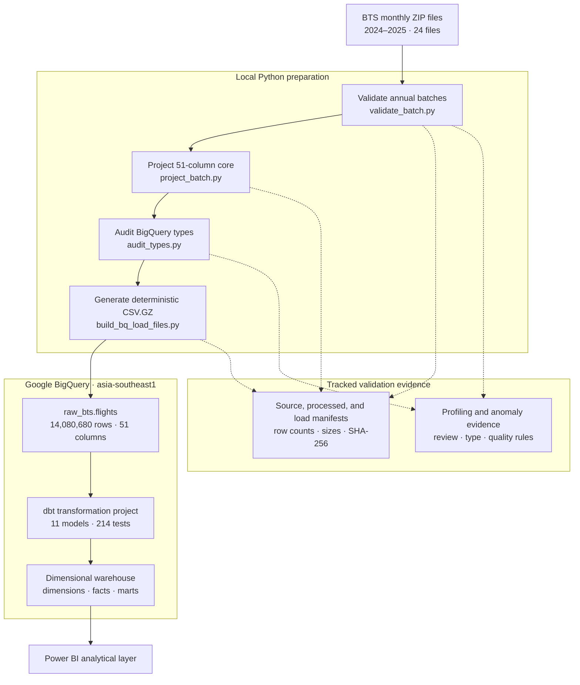
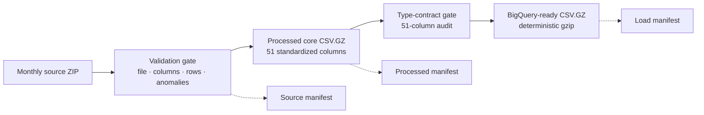
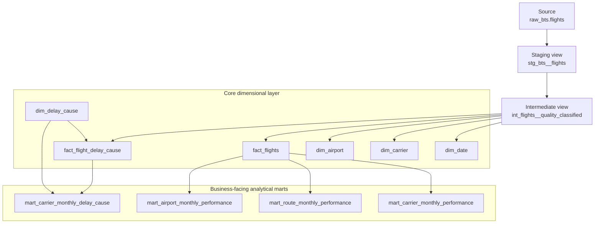
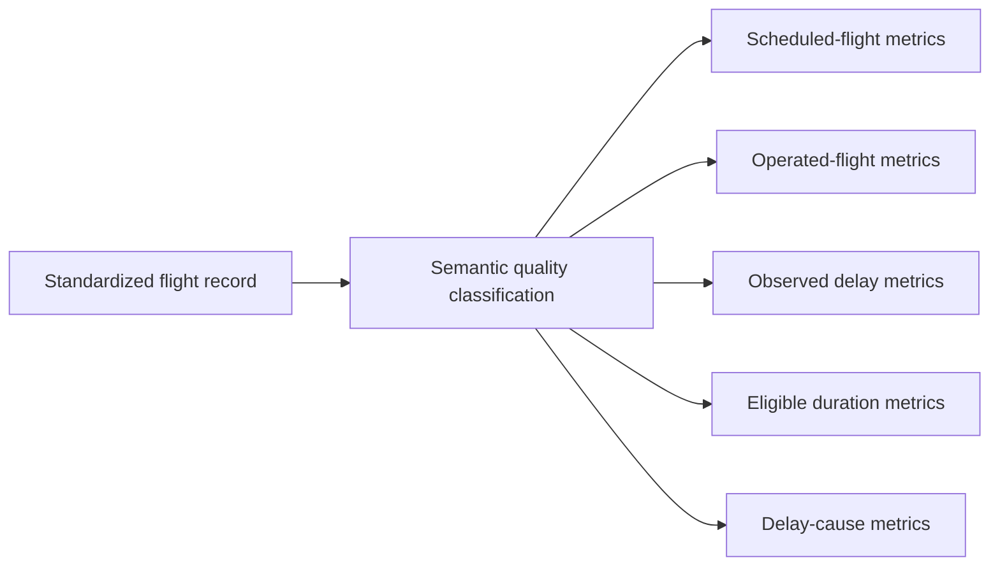
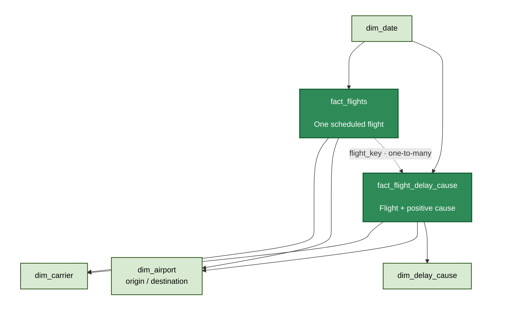
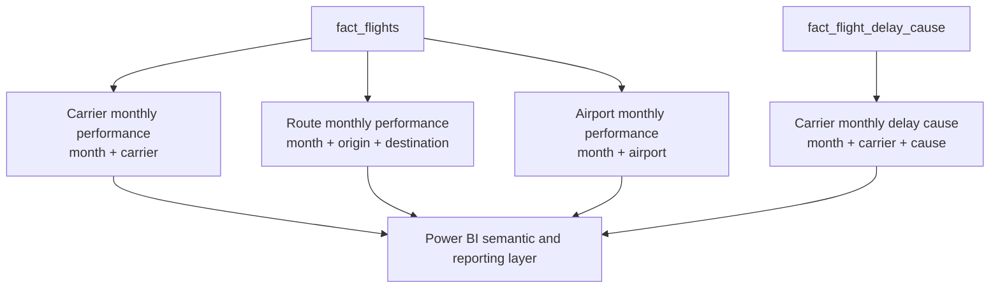
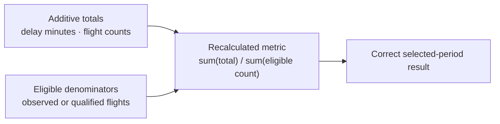
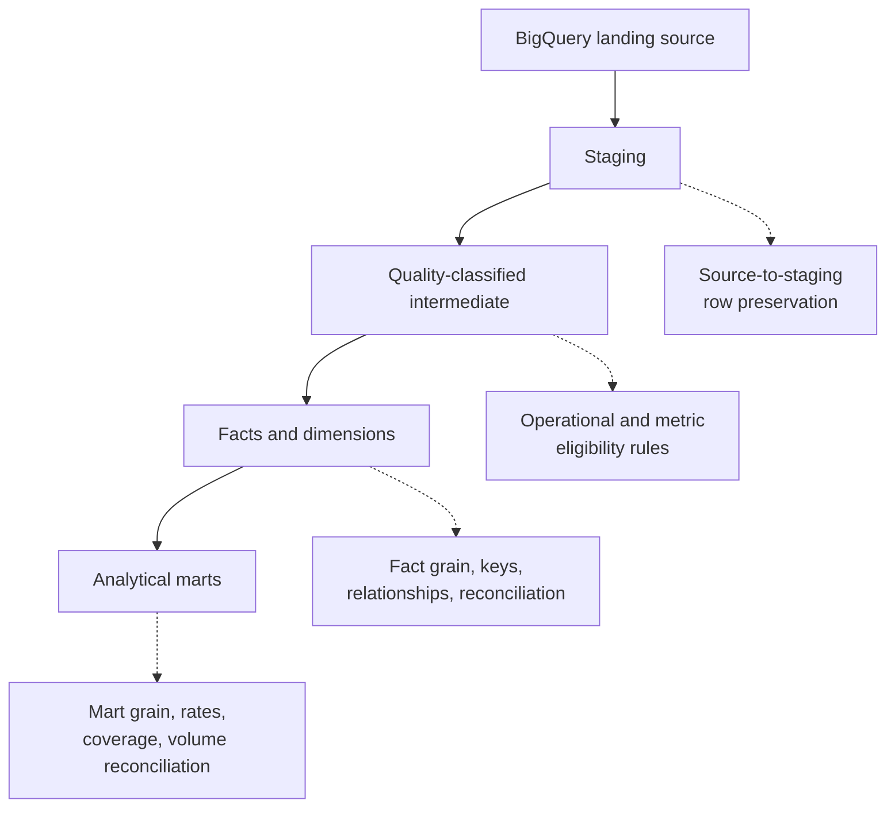
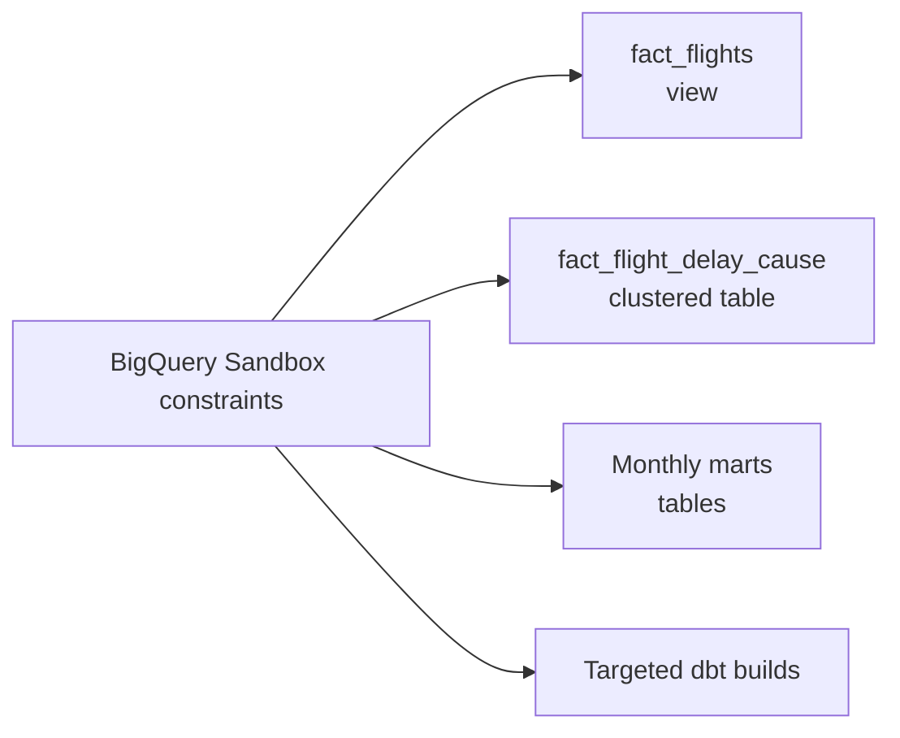

# BTS Airline Analytics Architecture

This document presents the technical architecture of the BTS Airline Analytics Engineering portfolio.

The project transforms 24 monthly US Bureau of Transportation Statistics Reporting Carrier On-Time Performance files covering 2024 and 2025 into a tested BigQuery dimensional warehouse and business-facing analytical marts.

Validated historical volume:

| Year | Monthly files | Flight records |
|---:|---:|---:|
| 2024 | 12 | 7,079,061 |
| 2025 | 12 | 7,001,619 |
| Total | 24 | 14,080,680 |

## 1. End-to-End Data Platform



### Architecture responsibilities

| Layer | Responsibility |
|---|---|
| BTS source | Provides monthly reporting-carrier flight-performance records |
| Python validation | Verifies file presence, schema behavior, row counts, and known anomalies |
| Core projection | Standardizes each month into the ordered 51-column contract |
| Type audit | Confirms compatibility with the explicit BigQuery schema |
| Load-file generation | Creates deterministic compressed files and load manifests |
| BigQuery landing | Stores the validated 2024–2025 flight history |
| dbt | Applies semantic rules, dimensional modeling, tests, and reconciliation |
| Analytical marts | Expose stable business grains and reusable measures |
| Power BI | Presents carrier, route, airport, and delay-cause analysis |

The local raw, processed, and load datasets are excluded from Git. Compact manifests, profiling outputs, configuration contracts, tests, and execution logs remain tracked as reproducibility evidence.

## 2. Local Data-Preparation Pipeline



### Validation gates

A reporting year is approved for BigQuery ingestion only when:

- all 12 expected monthly source files exist;
- source identities and hashes are understood;
- annual and monthly row counts reconcile;
- the projected files contain the ordered 51-column contract;
- the type audit covers all 51 columns;
- generated outputs match their manifest sizes and hashes;
- no interrupted `.tmp` files remain; and
- any review-status source conditions have supporting evidence.

The 2024 batch contains two reviewed months:

- July 2024
- August 2024

These months were approved through explicit anomaly investigation rather than silently treated as automatic passes.

## 3. BigQuery and dbt Transformation Layers



### Layer definitions

| Layer | Materialization | Role |
|---|---|---|
| Source | BigQuery table | Validated landing data |
| Staging | View | Naming, source flags, anomaly exposure, deterministic flight key |
| Intermediate | View | Central semantic and metric-eligibility classification |
| Core dimensions | Tables or seed | Reusable date, carrier, airport, and delay-cause entities |
| Flight fact | Sandbox view | Flight-grain analytical record |
| Delay-cause fact | Table | Sparse flight-and-positive-cause attribution |
| Analytical marts | Tables | Monthly business-facing aggregates |

## 4. Semantic Classification Boundary



The intermediate layer prevents downstream models from repeatedly interpreting operational edge cases.

Examples include:

- cancelled flights without observed departure or arrival values;
- diverted flights with incomplete destination outcomes;
- null operational durations;
- negative scheduled elapsed time;
- unavailable flight numbers requiring a validated fallback key; and
- delay-cause fields that are incomplete or ineligible for decomposition.

This is a semantic contract: a record can remain preserved in the flight-grain model while being excluded from a particular metric’s denominator.

## 5. Core Dimensional Warehouse
The core dimensional warehouse follows a fact-constellation, also called a galaxy-schema, pattern.

Two fact tables represent related analytical processes:

- `fact_flights` represents the scheduled-flight process.
- `fact_flight_delay_cause` represents positive BTS delay attribution associated with eligible flights.

The facts share conformed date, carrier, and airport dimensions. The sparse delay-cause fact additionally connects to the controlled delay-cause dimension.



### Galaxy-schema relationships

| Dimension | `fact_flights` | `fact_flight_delay_cause` | Role |
|---|:---:|:---:|---|
| `dim_date` | Yes | Yes | Shared flight-date calendar |
| `dim_carrier` | Yes | Yes | Shared BTS reporting-carrier identity |
| `dim_airport` | Yes | Yes | Role-playing origin and destination airport |
| `dim_delay_cause` | No | Yes | Controlled category for attributed delay minutes |

### Fact grains

| Fact | Grain | Analytical process |
|---|---|---|
| `fact_flights` | One reported scheduled flight | Flight operations, disruption, reliability, duration, taxi time, airtime, and distance |
| `fact_flight_delay_cause` | One eligible flight and positive delay cause | Sparse attribution of delay minutes across standardized BTS causes |

### Why this is a galaxy schema

A star schema normally centers on one fact table surrounded by dimensions.

This warehouse contains two related facts that reuse several conformed dimensions. That makes it a fact constellation or galaxy schema:

```text
Shared dimensions
       |
       +-- fact_flights
       |
       +-- fact_flight_delay_cause
```

The shared dimensions allow flight operations and delay attribution to be analyzed consistently by:

- date;
- carrier;
- origin airport; and
- destination airport.

`dim_delay_cause` is specialized because it applies only to the delay-attribution process.

A flight can contribute more than one positive delay-cause row. Therefore:

- `delay_minutes` is additive across delay causes;
- delay-cause rows are not distinct delayed flights;
- distinct flight analysis must use `flight_key`; and
- the relationship from `fact_flights` to `fact_flight_delay_cause` is conceptually one-to-many.

## 6. Analytical Mart Relationships



### Mart purposes

| Mart | Grain | Primary analytical purpose |
|---|---|---|
| `mart_carrier_monthly_performance` | Month and carrier | Carrier volume, reliability, delay, duration, taxi, and distance performance |
| `mart_route_monthly_performance` | Month, origin, and destination | Route traffic, disruption, reliability, and operating-time performance |
| `mart_airport_monthly_performance` | Month and airport | Inbound and outbound activity, delay, disruption, connectivity, and taxi behavior |
| `mart_carrier_monthly_delay_cause` | Month, carrier, and cause | Attributable delay burden, affected flight-cause records, severity, and cause share |

## 7. Metric Aggregation Design



The marts preserve additive totals and their eligible denominators so downstream tools can calculate correct results across arbitrary filter selections.

For example:

```text
Selected-period average arrival delay
=
sum(total_arrival_delay_minutes)
/
sum(arrival_observed_flights)
```

This is safer than averaging already-calculated monthly averages.

The same principle applies to:

- departure-delay averages;
- arrival-delay averages;
- scheduled and actual duration averages;
- airtime averages;
- taxi-in and taxi-out averages;
- cancellation rates;
- diversion rates;
- 15-minute delay rates; and
- delay-cause shares.

## 8. Testing and Reconciliation Architecture



The dbt project contains:

- 11 models;
- 214 data tests;
- 1 seed;
- 1 source; and
- 26 custom singular tests.

The latest preserved complete build result was:

```text
PASS=226 WARN=0 ERROR=0 SKIP=0 TOTAL=226
```

Testing covers:

- source-to-staging row preservation;
- staging-to-intermediate row preservation;
- deterministic flight-key validity;
- operational classification rules;
- metric-eligibility rules;
- duration eligibility;
- flight-fact row preservation;
- positive and unique delay-cause records;
- dimension-key relationships;
- mart grain uniqueness;
- rate boundaries;
- preservation of carrier, route, and airport month populations;
- fact-to-mart volume reconciliation; and
- delay-cause shares summing to approximately one.

## 9. Sandbox-Aware Physical Design



The current physical design reflects the project environment:

- `fact_flights` remains a view to avoid storing another full copy of the 14.1-million-row flight history;
- `fact_flight_delay_cause` is a non-partitioned clustered table because historical date partitions are subject to Sandbox expiration behavior;
- monthly analytical marts are tables;
- staging and intermediate models are views; and
- targeted builds reduce unnecessary BigQuery processing during development.

A future non-Sandbox production design may introduce:

- an incremental flight fact;
- date partitioning;
- additional clustering;
- source freshness;
- snapshots;
- orchestration;
- continuous integration; and
- controlled deployment environments.

These are future enhancements, not current-state claims.

## 10. Documentation Map

| Document | Purpose |
|---|---|
| `../scripts/README.md` | Python data-preparation workflow |
| `../analysis/profiling/README.md` | Profiling and validation evidence |
| `../dbt/README.md` | dbt models, tests, metrics, and operating guidance |
| `BIGQUERY_RUNBOOK.md` | Ingestion, validation, recovery, and acceptance procedure |
| `ARCHITECTURE.md` | End-to-end architecture and warehouse relationships |

These documents separate implementation guidance, operational procedure, evidence interpretation, and architectural explanation while remaining mutually consistent.